  

  
  
  
  

  

## About

Software engineer and designer based in the UAE, open to backend, full-stack and AI-application roles. I build CRM systems, SaaS platforms, AI-powered applications and business automation tools, and I care about the parts that have to hold up in production: REST APIs, database design, role-based access control, async processing and LLM pipelines.

I'm a founding engineer at Zypher Software Solutions, where I lead architecture and delivery for client products from schema design to deployment. I also design (Figma, Adobe Suite), and that background shows in the interfaces I ship.

## Stack

  
  
  
  
  
  
  
  
  
  
  
  
  
  
  
  
  
  
  
  

## Featured projects

| Project | What it does |
|---|---|
| [**HASH**](https://github.com/hanknixon/Hash) | AI-powered learning platform with content generation and real-time feedback. Multi-tenant API with RBAC and an LLM grading pipeline, piloted for two semesters with 200+ users. |
| **SecureThread** | Cybersecurity platform built on a SAST framework (SonarQube, Semgrep). Async APIs handling 5,000+ vulnerabilities across 200+ assets, with real-time reporting. |
| [**CareerWise**](https://github.com/hanknixon/CareerWise) | AI career recommendation tool using K-Means clustering and KNN, with an interactive UI and a backend dashboard. |
| [**E & S Decorations**](https://www.esdecorations.in/) | Responsive site for an event and home décor business, with an admin dashboard for content updates. |

More at [hanknixon.online](https://www.hanknixon.online/).

## Experience

| Role | Where | When |
|---|---|---|
| Founding Member & Software Engineer | Zypher Software Solutions | Jan 2026 – Present |
| Full Stack Developer Intern | People Maketh (remote) | Jul 2025 – Jul 2026 |
| Software Developer | Lylux Lighting Trading Equipment LLC (Dubai) | Jul 2025 – Jan 2026 |
| Software Development Intern | Partheon Research (remote) | Apr 2025 – Jun 2025 |
| Freelance Graphic Designer & Developer | Self-employed | Sep 2023 – Present |

## Activity

  <picture>
    <source media="(prefers-color-scheme: dark)" srcset="./profile/snake-dark.svg"/>
    <source media="(prefers-color-scheme: light)" srcset="./profile/snake-light.svg"/>
    
  </picture>

  
  

## Research & credentials

- Published: *Integrating AI-Powered Security into the SDLC* (IEEE / AICERA)
- Hackathons: 1× global runner-up, 2× national runner-up, 3× college/state runner-up
- Certifications: AWS Generative AI with LLMs, IBM Python for Data Science & AI, Google Data Analysis with R, NPTEL AI with Python and Cloud Computing Fundamentals

## Get in touch

Hiring or collaborating? Email **hank.enixon@gmail.com**, message me on [LinkedIn](https://www.linkedin.com/in/hanknixon/), or see the [portfolio](https://www.hanknixon.online/).
