  

  
  
  

  

## 👋 About

I build the parts of a product that have to hold up in production: REST APIs, database design, role-based access control, async processing and LLM-powered pipelines, with React or Flutter interfaces on top. I've shipped platforms for clients across e-commerce, CRM, inventory and education, from schema design through deployment. I also design (Figma, Adobe Suite), which keeps my interfaces usable.

B.Tech Information Technology (2026) · Founding engineer at **Zypher Software Solutions**

## ⚙️ Stack

  
  
  
  
  
   
  
  
  
  
   
  
  
  
  
   
  
  
  
  
   
  
  
  
  
  
  

## 🚀 Selected work

| Project | What it does | Stack |
|---|---|---|
| **Rental Management System** *(client work, private)* | Real-time cross-branch inventory sync with barcode scanning, plus an automated financial ledger. Built to scale to 5,000+ SKUs. | Python, React, Supabase |
| **SecureThreadOPS** | Vulnerability management platform. Async APIs handling 5,000+ vulnerabilities across 200+ assets, with LLM-assisted triage and risk-based scoring. | Python, FastAPI, React, PostgreSQL, Docker |
| [**HASH**](https://github.com/hanknixon/Hash) | AI-powered learning platform. Multi-tenant API with RBAC and an LLM grading pipeline, piloted for two semesters with 200+ users. | Python, FastAPI, React, PostgreSQL |
| [**CareerWise**](https://github.com/hanknixon/CareerWise) | NLP-based resume analysis and career-roadmap recommendations. | Python, NLP, Neo4j |
| [**E & S Decorations**](https://www.esdecorations.in/) | Live business website with an admin dashboard for real-time content updates. | Web |

## 💼 Experience

<b>Zypher Software Solutions</b> · Software Engineer · Jan 2026 – Present

Full-stack platforms, REST APIs and RBAC for 20+ clients; led architecture and delivery on 8+ projects.

<b>PeopleMaketh</b> · Full-Stack Developer Intern (remote) · 2025 – 2026

AI DevSecOps backend with LLM triage, async APIs and PostgreSQL schemas, and Slack ChatOps automation.

<b>Lylux Lighting Equipment Trading</b> · Software Engineer Intern (Dubai) · 2025

Product-catalogue APIs and data pipelines for 400+ products, bulk-edit validation, and a custom CRM.

## 🏆 Research & credentials

- Published: *Integrating AI-Powered Security into the SDLC* (IEEE / AICERA)
- Hackathons: 1× global runner-up, 2× national runner-up, 3× college/state runner-up
- Best Project at university for HASH · Principal's Honours
- Certifications: AWS Generative AI with LLMs, IBM Python for Data Science & AI, Google Data Analysis with R, NPTEL AI with Python and Cloud Computing Fundamentals

## 📬 Get in touch

Hiring or collaborating? Email **hank.enixon@gmail.com**, message me on [LinkedIn](https://www.linkedin.com/in/hanknixon/), or see my [portfolio](https://www.hanknixon.online/).

Outside the editor: gaming, photography, food, and planning the next trip.
